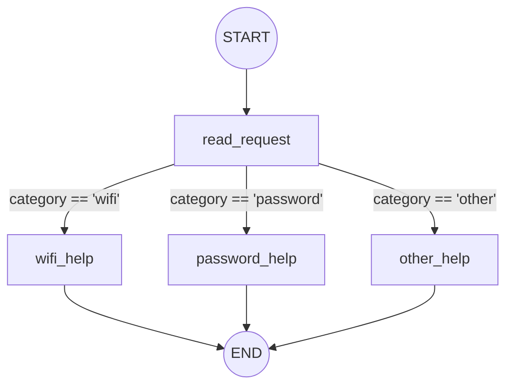
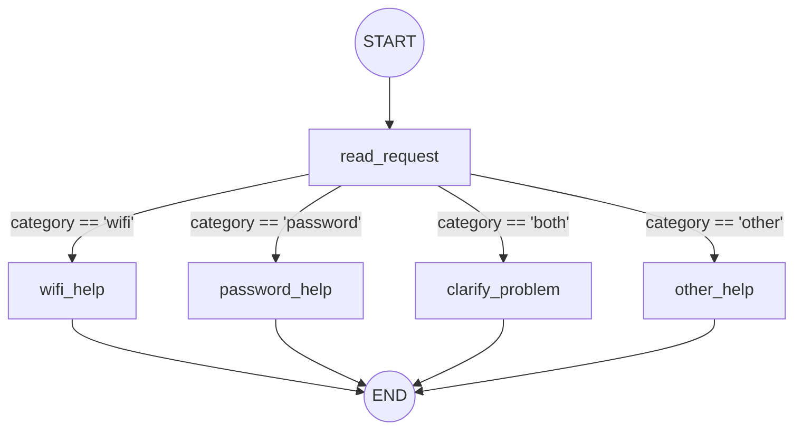
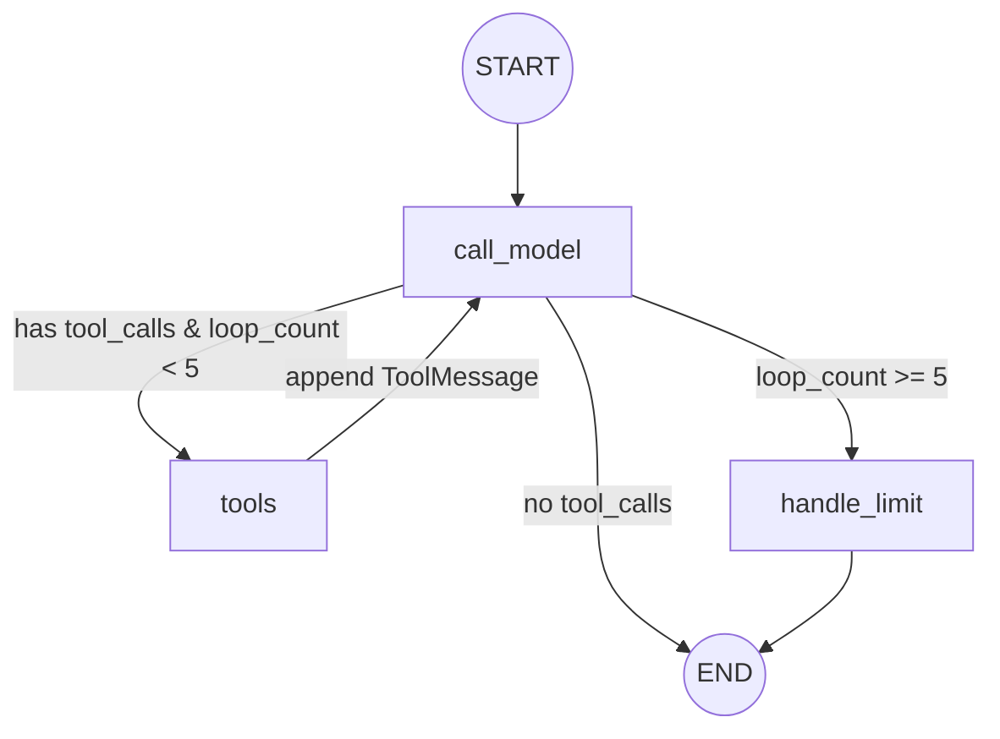

# HW5 — My LangGraph helpdesk

## Part 1 — How the graph works

### My graph and state

**Original Graph Structure (Text & Mermaid):**

```text
START ──► read_request ──► (conditional edge: route_request_original)
                             ├── "wifi"     ──► wifi_help     ──► END
                             ├── "password" ──► password_help ──► END
                             └── "other"    ──► other_help    ──► END
```



**What each node reads and changes:**
- `read_request`: Reads `state["message"]`, converts it to lowercase, checks for keywords (`wifi`/`wi-fi` or `password`), and writes `"wifi"`, `"password"`, or `"other"` into `state["category"]`.
- `wifi_help`: Reads the Wi-Fi troubleshooting steps from `data/helpdesk.json` and writes the combined instructions into `state["reply"]`.
- `password_help`: Reads the password recovery steps from `data/helpdesk.json` and writes them into `state["reply"]`.
- `other_help`: Does not need to read any fields from the state; it writes a fallback question (`"Are you having a problem with Wi-Fi or your password?"`) into `state["reply"]`.

**Answers to the four questions:**
1. **What information does each node need to read? What does it change?**  
   `read_request` reads `message` and changes `category`. The help nodes (`wifi_help`, `password_help`, `other_help`) do not read fields from the state; they only update the `reply` field using the local instructions from `data/helpdesk.json`.
2. **What is the difference between a node returning an update to the state and a conditional edge choosing the next node?**  
   A node returns a dictionary update that actually modifies the data stored in the state. A conditional edge does not modify the state at all; it only inspects the current state (such as `state["category"]`) and returns the name of the next node to visit.
3. **Does the next node receive only the previous node's update, or the current graph state?**  
   The next node always receives the full current graph state, which combines the initial input with all updates returned by previous nodes.
4. **What do `START`, `END`, and compiling a graph mean in this program?**  
   `START` is the virtual entry point that tells LangGraph where execution begins when an input arrives. `END` is the terminal marker telling the graph to stop running and return the final state. Compiling the graph (`workflow.compile()`) validates the nodes and edges, locks the structure, and turns the definition into an executable object that we can call with `.invoke()` or `.stream()`.

### Predictions before running

| Message | Predicted route | Actual route | What I learned |
| --- | --- | --- | --- |
| I cannot connect to Wi-Fi. | `START` → `read_request` → `wifi_help` → `END` | `START` → `read_request` → `wifi_help` → `END` | The `read_request` node matched `"wi-fi"`, set `category: "wifi"`, and routed to `wifi_help`. |
| I forgot my PASSWORD. | `START` → `read_request` → `password_help` → `END` | `START` → `read_request` → `password_help` → `END` | Converting the message with `.lower()` makes the routing case-insensitive, so `"PASSWORD"` matched `"password"`. |
| My laptop screen is broken. | `START` → `read_request` → `other_help` → `END` | `START` → `read_request` → `other_help` → `END` | When neither topic keyword is present, the `else` branch sets `category: "other"` and routes to `other_help`. |
| My Wi-Fi password does not work. | `START` → `read_request` → `wifi_help` → `END` | `START` → `read_request` → `wifi_help` → `END` | Because the `if has_wifi:` check comes before `elif has_password:`, the first rule wins and ignores the second keyword. |

**Why a message with both topics goes to Wi-Fi in the original graph:**  
When a message contains both `"Wi-Fi"` and `"password"`, `has_wifi` and `has_password` are both `True`. However, in `read_request_original`, the `if has_wifi:` condition is evaluated first in the `if / elif / else` chain. Once `if has_wifi:` matches, Python skips the `elif has_password:` branch and sets `category` to `"wifi"`.

### My change to the graph

**Updated Graph Structure with `clarify_problem` (Text & Mermaid):**

```text
START ──► read_request ──► (conditional edge: route_request_clarify)
                             ├── "wifi"     ──► wifi_help       ──► END
                             ├── "password" ──► password_help   ──► END
                             ├── "both"     ──► clarify_problem ──► END
                             └── "other"    ──► other_help      ──► END
```



**Execution trace Comparison for `"My Wi-Fi password does not work."`:**

```text
# Before graph change (Original Graph - S04):
Message: My Wi-Fi password does not work.
Node processed: read_request
State update: {'read_request': {'category': 'wifi'}}
Node processed: wifi_help
State update: {'wifi_help': {'reply': 'Check that Wi-Fi is enabled and airplane mode is off. Select the fictional Campus-Demo network. If connection fails, forget the saved network and try connecting again. If the problem remains, check the service status before preparing a ticket.'}}

# After graph change (Updated Graph - S05):
Message: My Wi-Fi password does not work.
Node processed: read_request
State update: {'read_request': {'category': 'both'}}
Node processed: clarify_problem
State update: {'clarify_problem': {'reply': 'Is the problem connecting to Wi-Fi, or recovering your account password?'}}
```

**Explanation of the difference and control:**
- **What changed:** I updated `read_request_clarify` to check `if has_wifi and has_password:` first, setting `category` to `"both"`, and added a new `clarify_problem` node to the graph and conditional edge map. Instead of silently assuming the user wants Wi-Fi instructions, the graph now takes a separate branch and asks the user which issue they want to solve first.
- **What LangGraph controls vs. what my Python functions decide:** LangGraph controls the state lifecycle and execution order—it passes the current state dictionary into a node, merges the returned update into the shared state, calls the routing function on the conditional edge, and invokes the chosen target node until reaching `END`. My Python functions make the actual decisions: they inspect the string for keywords, choose which category value or node name to return, and construct the reply text.

## Part 2 — Model and tools

### Model/tool execution loop

**Loop Diagram (Text & Mermaid):**

```text
START ──► call_model ──► (conditional edge: route_after_model)
            ▲              ├── has tool_calls & loop_count < 5 ──► tools ────────┘
            │              ├── loop_count >= 5                 ──► handle_limit ──► END
            └──────────────└── no tool_calls (final answer)    ──► END
```



**Model, provider, and loop limit:**
- **Provider & Model:** OpenAI (`langchain-openai` adapter) using `gpt-4o-mini` with `temperature=0`.
- **Where the loop limit is enforced:** In `part2.py`, the state tracks `loop_count` (incremented inside `call_model` on every model invocation). The conditional edge function `route_after_model` checks `if state.get("loop_count", 0) >= MAX_TOOL_LOOPS` (set to `5`). If the limit is reached while the model still requests tools, it routes to `handle_limit` -> `END` and sets `loop_limit_reached: True` so the graph cannot loop forever.

**Answers to the four questions:**
1. **How does the graph decide between running a tool and ending with an answer?**  
   After `call_model` runs, the conditional edge `route_after_model` inspects the last `AIMessage` in `state["messages"]`. If `last_msg.tool_calls` is non-empty (and `loop_count < MAX_TOOL_LOOPS`), the graph routes to the `tools` node. Once the model returns a plain text reply with no `tool_calls`, the edge routes to `END`.
2. **Which component requests a tool, and which component actually executes it?**  
   The LLM (`ChatOpenAI` bound with `.bind_tools(TOOLS)`) only *requests* a tool by returning structured `tool_calls` (name and arguments) inside an `AIMessage`. It never runs Python code itself. Our `tools` node (`execute_tools` function in Python) reads those arguments, calls the actual Python function (`find_instructions`, `check_service_status`, or `prepare_ticket`), and packages the output into a `ToolMessage`.
3. **What changes in the state after a tool result returns?**  
   The `tools` node appends a `ToolMessage` (containing the JSON string returned by the Python tool, the tool name, and the matching `tool_call_id`) to `state["messages"]`. If `prepare_ticket` created a draft file, its path is also appended to `state["ticket_files"]`. When control returns to `call_model`, the model sees its previous tool request paired with the new `ToolMessage` in the message history.
4. **What makes this part different from the fixed routing rules in Part 1?**  
   In Part 1, routing was hard-coded with `if/elif` keyword checks and always followed a single pass from `START` to `END`. In Part 2, the LLM dynamically decides which tool(s) to call, in what order, and whether to call another tool after reading the previous tool's result (for example, checking `check_service_status` first and only calling `prepare_ticket` if the status is `"operational"`).

### Direct tool calls (without the agent)

All three tools in `tools.py` work directly as regular Python functions:

```text
[Direct call] find_instructions('wifi'):
{
  "topic": "wifi",
  "instruction_id": "GUIDE-WIFI",
  "title": "Connect to the practice campus network",
  "steps": [
    "Check that Wi-Fi is enabled and airplane mode is off.",
    "Select the fictional Campus-Demo network.",
    "If connection fails, forget the saved network and try connecting again.",
    "If the problem remains, check the service status before preparing a ticket."
  ],
  "source": "data/helpdesk.json"
}

[Direct call] check_service_status('wifi', status_profile='normal'):
{
  "service": "wifi",
  "status_profile": "normal",
  "status": "operational",
  "message": "The demo Wi-Fi service has no reported outage.",
  "source": "data/service_status.json"
}

[Direct call] prepare_ticket(...):
{
  "created": true,
  "delivery": "local draft only",
  "file_path": "outputs/ticket_direct-test_TCK-DIRECT-TEST-B927.json",
  "ticket": {
    "ticket_id": "TCK-DIRECT-TEST-B927",
    "status": "draft",
    "user_id": "demo-user-a",
    "thread_id": "direct-test",
    "category": "wifi",
    "summary": "Cannot connect to Campus-Demo Wi-Fi",
    "steps_tried": [
      "Enabled Wi-Fi",
      "Forgot the saved network"
    ],
    "service_status": "operational",
    "status_profile": "normal",
    "reference_ids": [
      "GUIDE-WIFI"
    ]
  }
}
```

### Multi-tool run and snapshot comparison

**Conditional multi-tool interaction across snapshots (`normal` vs `wifi_outage` vs `status_unavailable`):**

```text
--- S06 Demo - Normal Status (status_profile=normal) ---

User: Show me the Wi-Fi troubleshooting steps.
Node visited: call_model
  [Tool Request] find_instructions({'topic': 'wifi'})
Node visited: tools
  [Tool Result - find_instructions] {"topic": "wifi", "instruction_id": "GUIDE-WIFI", "title": "Connect to the practice campus network", "steps": ["Check that Wi-Fi is enabled and airplane mode is off.", "Select the fictional Campus-Demo network.", "If connection fails, forget the saved network and try connecting again.", "If the problem remains, check the service status before preparing a ticket."], "source": "data/helpdesk.json"}
Node visited: call_model
Helpdesk: Here are the Wi-Fi troubleshooting steps for connecting to the Campus-Demo network:
1. Check that Wi-Fi is enabled and airplane mode is off.
2. Select the fictional Campus-Demo network.
3. If connection fails, forget the saved network and try connecting again.
4. If the problem remains, check the service status before preparing a ticket.

User: I enabled Wi-Fi and forgot the saved network, but Campus-Demo still will not connect. Check whether Wi-Fi is down. If it is operating, prepare a ticket about this problem.
Node visited: call_model
  [Tool Request] check_service_status({'service': 'wifi'})
Node visited: tools
  [Tool Result - check_service_status] {"service": "wifi", "status_profile": "normal", "status": "operational", "message": "The demo Wi-Fi service has no reported outage.", "source": "data/service_status.json"}
Node visited: call_model
  [Tool Request] prepare_ticket({'category': 'wifi', 'summary': 'Unable to connect to Campus-Demo network after enabling Wi-Fi and forgetting the saved network.', 'steps_tried': ['Enabled Wi-Fi', 'Forgot the saved network'], 'service_status': 'operational', 'reference_ids': ['GUIDE-WIFI']})
Node visited: tools
  [Tool Result - prepare_ticket] {"created": true, "delivery": "local draft only", "file_path": "outputs/ticket_s06_TCK-S06-E39F.json", "ticket": {"ticket_id": "TCK-S06-F183", "status": "draft", "user_id": "demo-user-a", "thread_id": "s06", "category": "wifi", "summary": "Unable to connect to Campus-Demo network after enabling Wi-Fi and forgetting the saved network.", "steps_tried": ["Enabled Wi-Fi", "Forgot the saved network"], "service_status": "operational", "status_profile": "normal", "reference_ids": ["GUIDE-WIFI"]}}
Node visited: call_model
Helpdesk: The Wi-Fi service is operational. I have prepared a ticket draft regarding your issue with connecting to the Campus-Demo network.
- Summary: Unable to connect to Campus-Demo network after enabling Wi-Fi and forgetting the saved network.
- Steps Tried: Enabled Wi-Fi, Forgot the saved network.
The ticket has been saved as a local draft. You can find it at the following path: outputs/ticket_s06_TCK-S06-E39F.json.

--- S07 Demo - Wi-Fi Outage (status_profile=wifi_outage) ---

User: I enabled Wi-Fi and forgot the saved network, but Campus-Demo still will not connect. Check whether Wi-Fi is down. If it is operating, prepare a ticket about this problem.
Node visited: call_model
  [Tool Request] check_service_status({'service': 'wifi'})
Node visited: tools
  [Tool Result - check_service_status] {"service": "wifi", "status_profile": "wifi_outage", "status": "outage", "message": "The demo Wi-Fi service is unavailable across campus. The fixture gives no repair time.", "source": "data/service_status.json"}
Node visited: call_model
Helpdesk: The Wi-Fi service is currently experiencing an outage across campus, and no repair time is provided. Therefore, I cannot prepare a ticket for your issue since the condition was not met.

--- S08 Demo - Status Unavailable (status_profile=status_unavailable) ---

User: Check whether Wi-Fi is down. If it is operating, prepare a ticket. I already enabled Wi-Fi and reconnected, with no success.
Node visited: call_model
  [Tool Request] check_service_status({'service': 'wifi'})
Node visited: tools
  [Tool Result - check_service_status] {"service": "wifi", "status_profile": "status_unavailable", "status": "unknown", "message": "The demo Wi-Fi status source is unavailable.", "source": "data/service_status.json"}
Node visited: call_model
Helpdesk: The status source for the Wi-Fi service is currently unavailable, so I cannot confirm if it is operating. Would you still like me to prepare a ticket draft, noting that the status could not be checked?
```

## Part 3 — Memory

### How conversation memory, user memory, and retrieval work

- **Conversation state and `thread_id`:** Conversation history (`state["messages"]`) is persisted locally in `local-storage/checkpoints.sqlite` using LangGraph's `SqliteSaver` checkpointer. When calling the graph, we pass `config={"configurable": {"thread_id": thread_id}}`. A `thread_id` identifies a single conversation session (e.g., `"s10"` or `"restart-a"`). If the program closes and restarts with the same `thread_id`, `SqliteSaver` automatically reloads the previous messages from SQLite so the assistant knows what problem and troubleshooting steps were already discussed.
- **User identifier (`user_id`) and user preference storage:** A `user_id` (such as `"demo-user-a"` or `"demo-user-b"`) identifies the person using the helpdesk across multiple conversations. User preferences (such as `{"preferred_language": "Kazakh"}`) are stored separately in `local-storage/user_preferences.json` keyed by `user_id`. At the start of every turn, the `user_memory` node loads the record for `state["user_id"]` directly in Python (so the LLM can never choose or spoof another user's ID) and injects it into the system prompt. When a user says `"Please remember that I prefer replies in Kazakh"`, `user_memory` saves that preference under their `user_id`.
- **Difference between `thread_id` and `user_id`:** One user (`user_id = "demo-user-a"`) can start many different conversations (`thread_id = "preference-a1"`, `thread_id = "preference-a2"`). Each `thread_id` keeps an isolated message transcript, while `user_id` shares saved preferences across all threads belonging to that same user without leaking them to `"demo-user-b"`.
- **Retrieval from `helpdesk.json` vs. Memory:** Looking up Wi-Fi or password steps in `data/helpdesk.json` via `find_instructions` is **retrieval** from static reference documentation that is identical for every user and never changes during a chat. Recalling what steps a user already tried (`SqliteSaver` conversation state) or that `demo-user-a` prefers replies in Kazakh (`user_preferences.json`) is **memory**, because that information was learned dynamically from earlier user interactions and persisted for future turns.

### Memory situations

| Situation | Command used | Log file | What happened |
| --- | --- | --- | --- |
| Refer to an earlier message | `python helpdesk.py --user demo-user-a --thread s10 --profile normal --message "Which steps did I already try?"` | `outputs/S10.log` | Loaded previous turn from `conversation_state` (`thread_id="s10"`) and recalled that the user enabled Wi-Fi and forgot the saved network. |
| Close, restart and resume | `python helpdesk.py --user demo-user-a --thread restart-a --profile normal --message "Which problem and steps did we discuss?"` | `outputs/S11.log` | After process termination and restart, `SqliteSaver` reloaded thread `"restart-a"` and `user_memory` loaded `preferred_language: "Kazakh"`, answering about the Wi-Fi issue in Kazakh. |
| Same user, new conversation | `python helpdesk.py --user demo-user-a --thread preference-a2 --profile normal --message "Which language did I ask you to use? What can you help with?"` | `outputs/S12.log` | Started a fresh thread `"preference-a2"` with no old messages, loaded `preferred_language: "Kazakh"` from `user_memory` (`user_preferences.json`), and replied in Kazakh. |
| Different user | `python helpdesk.py --user demo-user-b --thread isolation-b --profile normal --message "Have I told you a preferred language or a previous problem?"` | `outputs/S13.log` | Checked `user_preferences.json` for `"demo-user-b"` and thread `"isolation-b"`, found both empty, and confirmed no language preference or prior problem was recorded. |

## Part 4 — Running and checking my work

### Setup, pinned versions, and memory reset

- **README setup & commands:** Full installation steps, environment variable configuration (`.env`), CLI commands (`helpdesk.py`, `part1.py`, `part2.py`, `run_scenarios.py`), and Python version details are documented in [README.md](README.md).
- **Pinned package versions:** Exact tested versions are pinned in [requirements.txt](requirements.txt).
- **Where memory is saved and how to reset it:**
  - Conversation checkpoints are stored in `local-storage/checkpoints.sqlite` (via `SqliteSaver`).
  - User preferences are stored in `local-storage/user_preferences.json` keyed by `user_id`.
  - To clear all memory and start fresh, run:
    ```bash
    python helpdesk.py --reset
    ```
    or delete the `local-storage/` folder manually.
- **GitHub Actions workflow:** Configured in [.github/workflows/ci.yml](.github/workflows/ci.yml) to run `pytest -v` automatically on every push and pull request without requiring a private OpenAI API key.

### Automated tests (`tests/test_helpdesk.py`) and fake model usage

All automated tests in `tests/test_helpdesk.py` run offline without an API key. Tests 3 and 4 use `FakeHelpdeskChatModel` (a clearly labelled fake model that implements `.bind_tools()` and `.invoke()`), while all scenario logs in `outputs/S06.log`–`outputs/S14.log` and `part2.py` / `helpdesk.py` runs use the real OpenAI `gpt-4o-mini` model.

| Test function | Uses fake model? | What mistake it catches if the code breaks |
| --- | --- | --- |
| `test_part1_routing_and_clarification` | No (Part 1 has no LLM) | Catches broken case-insensitivity (e.g., failing on `"PASSWORD"`), missing fallback routing, or regressions where a message with both `"Wi-Fi"` and `"password"` fails to route to `clarify_problem` in the updated graph. |
| `test_three_tools_directly` | No (direct Python calls) | Catches broken JSON lookups in `find_instructions` or `check_service_status`, wrong snapshot profile mappings, or `prepare_ticket` creating a ticket when `steps_tried` is empty. |
| `test_agent_multi_tool_and_loop_limit_with_fake_model` | Yes (`FakeHelpdeskChatModel`) | Catches failures in the `call_model` ↔ `tools` graph edges, missing `ToolMessage` state updates, or a broken loop counter that allows an infinite tool-calling loop to exceed `MAX_TOOL_LOOPS = 5`. |
| `test_memory_persistence_and_user_isolation` | Yes (`FakeHelpdeskChatModel`) | Catches lost conversation state after closing and reopening SQLite, failure to carry `preferred_language` to a new `thread_id` for the same user, or leaking `demo-user-a`'s preference to `demo-user-b`. |

## Choices and limitations

- **Libraries and storage chosen:**
  - **LangGraph (`StateGraph`) & `langchain-openai` (`ChatOpenAI` with `gpt-4o-mini`):** Fits this helpdesk task well because `StateGraph` gives explicit control over node routing, state updates, and the `MAX_TOOL_LOOPS` guard, while `gpt-4o-mini` reliably handles structured tool calling and Kazakh replies.
  - **Conversation memory (`langgraph-checkpoint-sqlite` / `SqliteSaver`):** Stores thread checkpoints in a single local file (`local-storage/checkpoints.sqlite`). It requires no external database server, survives full process restarts, and cleanly separates threads via `thread_id`.
  - **User memory (`local-storage/user_preferences.json`):** Stores per-user preferences in a simple JSON dictionary keyed by `user_id`. Loading and saving preferences inside the Python `user_memory` node ensures the model cannot accidentally read or overwrite another user's profile.
- **Current limitations:**
  - **Rule-based preference extraction:** The `user_memory` node detects language preferences using regular expressions (such as `"prefer replies in <Language>"` or `"reply in <Language>"`). If a user phrases their preference in a very unusual way (e.g., `"Қазақша сөйлеші"` without English keywords), the regex may miss it unless expanded or paired with a structured extraction step.
  - **Single-writer local storage:** SQLite and a flat JSON file work well for a single terminal user, but concurrent multi-process writes in a high-traffic web deployment would require PostgreSQL and file locking.

## Supplied scenarios — my actual results

| Scenario | Command or manual steps | Log file | What happened / what I changed |
| --- | --- | --- | --- |
| S01 — Simple Wi-Fi route | `python run_scenarios.py` (runs `graph_v1` on `"I cannot connect to Wi-Fi."`) | `outputs/S01.log` | `read_request` matched `"wi-fi"`, set `category="wifi"`, and routed to `wifi_help`, returning the 4 steps from `GUIDE-WIFI`. |
| S02 — Case-insensitive password route | `python run_scenarios.py` (runs `graph_v1` on `"I forgot my PASSWORD."`) | `outputs/S02.log` | `.lower()` normalized `"PASSWORD"`, set `category="password"`, and routed to `password_help` (`GUIDE-PASSWORD`). |
| S03 — Unsupported request | `python run_scenarios.py` (runs `graph_v1` on `"My laptop screen is broken."`) | `outputs/S03.log` | Neither keyword matched; `read_request` set `category="other"` and `other_help` asked if the issue is with Wi-Fi or password. |
| S04 — Two topics before the graph change | `python run_scenarios.py` (runs `graph_v1` on `"My Wi-Fi password does not work."`) | `outputs/S04.log` | Because `if has_wifi:` runs before `elif has_password:` in `graph_v1`, it ignored `"password"` and routed straight to `wifi_help`. |
| S05 — Two topics after adding clarification | `python run_scenarios.py` (runs `graph_v2` on `"My Wi-Fi password does not work."`) | `outputs/S05.log` | Added `if has_wifi and has_password:` and the `clarify_problem` node in `graph_v2`; the graph now sets `category="both"` and asks which issue to solve first. |
| S06 — Instructions then local ticket | `python helpdesk.py --reset` then two turns on `--thread s06 --profile normal` | `outputs/S06.log` | Turn 1 called `find_instructions(topic="wifi")`. Turn 2 called `check_service_status(service="wifi")` (`operational`) and then `prepare_ticket`, saving a local draft in `outputs/`. |
| S07 — The same request during a Wi-Fi outage | `python helpdesk.py --reset` then `--thread s07 --profile wifi_outage` | `outputs/S07.log` | Called `check_service_status(service="wifi")`, saw `status="outage"`, did **not** call `prepare_ticket` because the service was not operating, and noted that no repair time is given. |
| S08 — Status source unavailable | `python helpdesk.py --reset` then `--thread s08 --profile status_unavailable` | `outputs/S08.log` | Called `check_service_status(service="wifi")`, saw `status="unknown"`, did not create a ticket automatically, and asked if the user wants a draft noting status could not be checked. |
| S09 — Missing ticket details | `python helpdesk.py --reset` then two turns on `--thread s09 --profile normal` | `outputs/S09.log` | Turn 1 (`"Prepare a support ticket."`) did not call `prepare_ticket` and asked for the problem and steps tried. Turn 2 received the Wi-Fi details and created the local ticket draft. |
| S10 — Use the current conversation | `python helpdesk.py --reset` then two turns on `--thread s10 --profile normal` | `outputs/S10.log` | Turn 2 loaded Turn 1 from `conversation_state` (`SqliteSaver`) and accurately listed the steps the user already tried (enabled Wi-Fi, forgot saved network). |
| S11 — Persist and recall after restart | Turn 1 on `--thread restart-a`, full process exit, Turn 2 in a new process on `--thread restart-a` | `outputs/S11.log` | Saved Kazakh preference (`user_preferences.json`) and thread messages (`checkpoints.sqlite`). After process restart, recalled the Wi-Fi issue and steps tried and answered in Kazakh. |
| S12 — Preference across threads without replay | Turn 1 on `--thread preference-a1`, process restart, Turn 2 on new `--thread preference-a2` | `outputs/S12.log` | In the new thread `preference-a2`, `user_memory` loaded `preferred_language="Kazakh"` for `demo-user-a` without old messages and answered in Kazakh about its capabilities. |
| S13 — Do not share memory between users | Turn 1 as `demo-user-a` (`isolation-a`), Turn 2 as `demo-user-b` (`isolation-b`) | `outputs/S13.log` | `demo-user-b` had an empty profile in `user_preferences.json` and a separate thread, so the assistant confirmed no language preference or previous problem was recorded for `demo-user-b`. |
| S14 — Password recovery outage | `python helpdesk.py --reset` then `--thread s14 --profile recovery_outage` | `outputs/S14.log` | Mapped password recovery to `check_service_status(service="account_recovery")`, saw `status="outage"`, and reported the known outage with no estimated repair time. |
